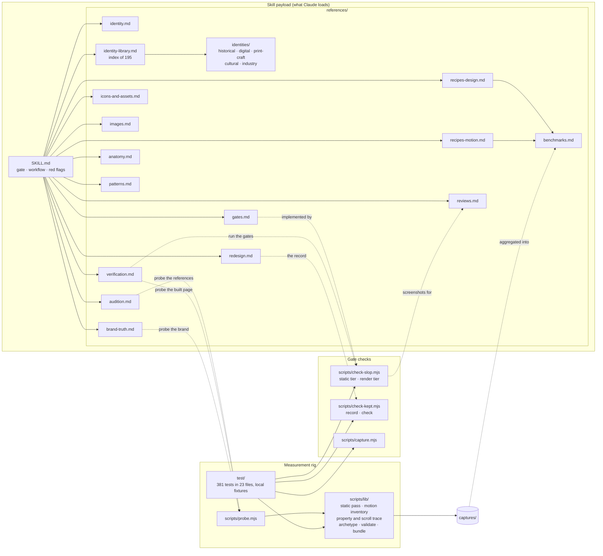
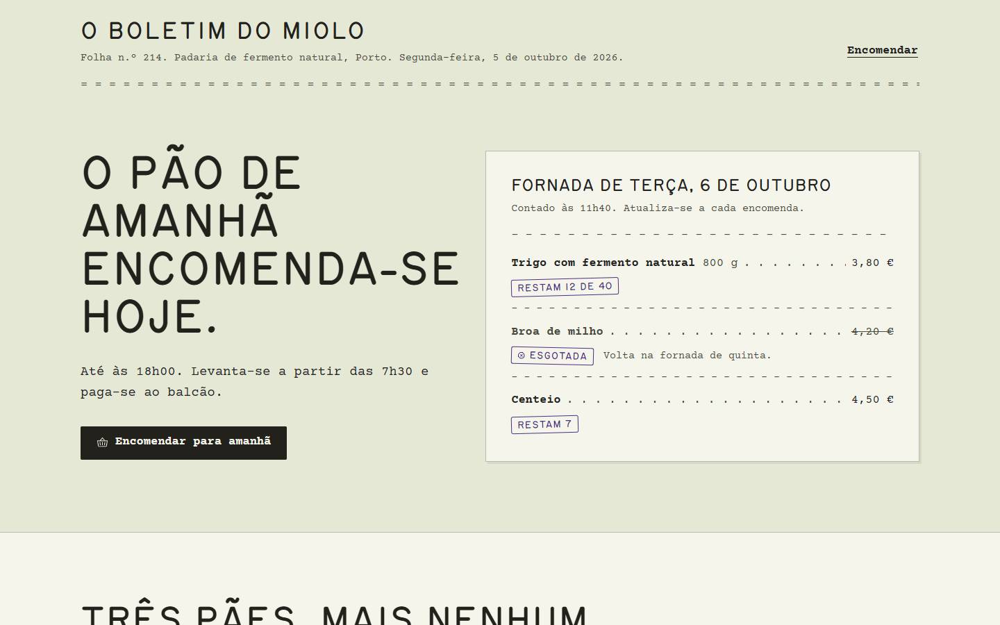
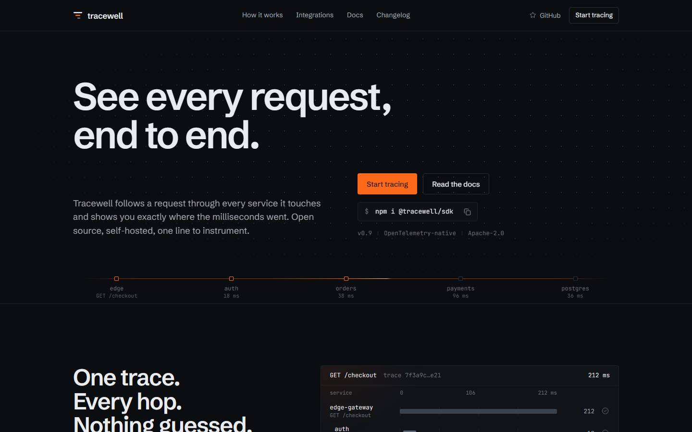
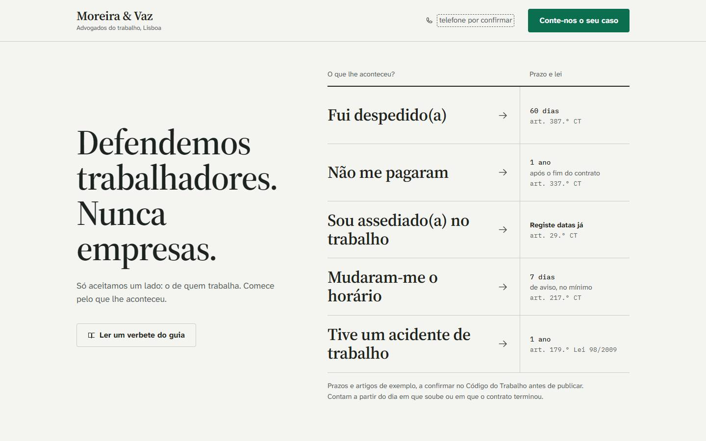
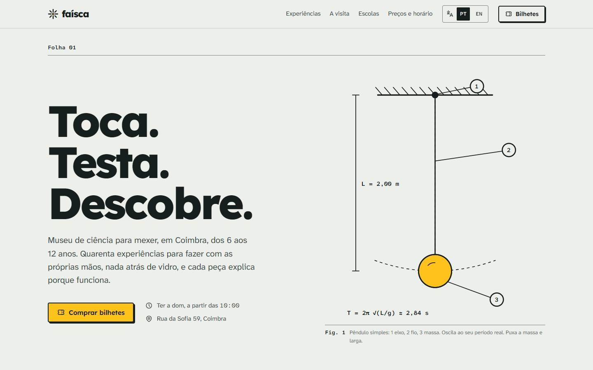

# df-design

A Claude Code skill for web design and motion, plus the measurement rig that
built it.

Most design guidance is taste asserted confidently. This is thirty production
sites loaded in a real browser and measured — and the prober that did the
measuring ships with it, so every number is reproducible and every claim is
checkable against a site you choose.

`SKILL.md` is the payload Claude loads. This README is for the human reading
the directory.

---

## Use the skill

Anything you write when calling the skill is read first, as **step 0**, and
binds the whole run: scope, constraints, early answers and notes.

```
/df-design only rework the main page, keep the logo and the green
```

That run touches the main page and nothing else. Research, auditions,
assets, the loading tier and the consistency check are all limited to it,
and clashes with untouched pages are reported as notes, not fixed.

When the target already exists, the note can also say how deep to go:

```
/df-design audit the current homepage             # a report, nothing changed
/df-design polish: only fix what looks generated  # the tells, in place
/df-design keep the layout, restyle around the green
/df-design redesign the site                      # keep the content and the wiring, change the rest
```

Before a redesign starts, `scripts/check-kept.mjs record` writes down every
link, field, form, handler, test hook and script the page has; after it,
`check` fails the redesign if any went missing without a reason on the
record (`references/redesign.md`).

Then every run opens with two answers, declared before anything else happens
(a third question, whether the work will be sold and so needs a watermark,
rides in the same message but never blocks the start):

```
path:  audition   # compare candidate identities as small HTML pages, choose, then build
       design     # build directly; the identity is still defined and written down first

mode:  motion     # animation only — identity is settled, not yours to change
       design     # identity and structure — no animation
       both       # a rebrand — identity first, then structure, then motion
```

That is not ceremony. The failure this skill exists to prevent is delivering a
finish-level change when someone asked for a structural one — new tokens and
type on the same layout, handed over as "a rebrand". If the request does not
make either answer obvious, Claude asks instead of guessing.

Path and mode are not generator switches. They select stages of one workflow:

```
Author intent → Identity definition → Reference & identity research
  → Playwright decision → Design direction → HTML audition → Author selection
  → [selling-positioning: now / end / skip]*
  → Identity brief → Implementation → Consistency validation → Verification
                                       * optional detour, see below
```

The optional **selling-positioning** detour, offered once the identity is
chosen, produces a complete logo presentation and the identity's positioning
(from the identity and the author's intent, with no market research; real
mockups; the chosen site shown as part of the work) as an HTML slideshow,
slides, social images and a PDF. The author picks the motion tier of the
slideshow (`fast`, `medium` or `high`), and may choose a logo proposal,
combine parts of several, or redirect.
If the work is being sold, a **protective watermark** (a text pattern, or
the author's image plus text, at low opacity) goes on everything shown,
with a clean copy kept for delivery after payment.

A few rules run through all of it:

- **A reference is not an identity.** A link, a screenshot or a video shows
  what the project *could* be. Claude classifies what each reference
  demonstrates (layout, typography, interaction, an alternative presentation,
  and so on) and weighs it below the author's stated intent.
- **The identity library is the search engine.** `references/identity-library.md`
  indexes a gallery of named visual identities. Each has its grammar, what it
  says, fit, trap, loading cost, live sites that ship it, and search leads.
  Claude uses it to propose directions the author would not have reached, then
  researches past the first acceptable reference.
- **The approved identity binds every surface.** Landing, app, admin, DevOps,
  docs and 404 are one product. Density adapts; identity does not.
- **One surface at a time.** On a project with several surfaces (landing,
  admin, ops, 404), Claude finishes one before starting the next: its own
  spec, the author's approval, the build and a look at the result. Surface
  specs never borrow each other's premises; what is shared lives in the
  identity brief.
- **The author picks the loading tier.** Claude recommends the cheapest tier
  that fully delivers the identity, then offers fast, medium and high
  expensive loading, each described and costed for this project, plus a
  fourth "custom / unrestricted" choice if the author declines the
  recommendation. The question comes with the candidates, every run, even
  when every candidate is fast, and is confirmed after the assets are
  priced. When the author combines candidates or techniques from different
  tiers, each technique is listed with its own tier and cost and the author
  keeps or drops each one. A heavier tier has to be justified in the
  identity brief.

- **Icons always; stock images only with the author's yes.** Every image must
  be free for commercial use, need no credit line and carry no watermark in
  the file that ships. In `motion` and `both`, the icons and images are part
  of the motion plan.

In `both`, the order is fixed: **identity → structure → motion.** Motion
applied to a generic layout produces a generic layout that moves.

---

## Architecture

### The workflow

What happens in one run, and which file drives each stage. Dashed stages run
only on the audition path. In `motion` mode, the identity stages shrink to
reading the identity the site already has.

```mermaid
flowchart TD
    Z["Step 0: invocation note<br/>scope · constraints · notes<br/>binds every stage"] --> A
    A["Brief from the author"] --> G{"Path and mode<br/>+ practical requirements<br/>+ may I use stock images?"}
    G --> I["Author intent and<br/>reference classification"]
    I --> L["Library search<br/>sector default → shortlist → cuts"]
    L --> R["Research<br/>past the first good reference, rejects logged<br/>+ shortlist image sources and icon sets"]
    R --> P{"Playwright<br/>allowed?"}
    P -->|yes| PR["Probe references"]
    P -->|no| NB["Non-browser tooling;<br/>author does the looking"]
    PR --> D["Three candidate directions"]
    NB --> D
    D -.audition path.-> AU["HTML auditions<br/>same content, tier message<br/>priced per candidate"]
    AU -.-> S["Author selects,<br/>combines or rejects"]
    S -.-> AS
    D -->|design path| AS["Assets<br/>one icon set (mandatory)<br/>+ approved images: free, commercial,<br/>no credit, no watermark"]
    AS --> T{"Loading tier confirmed<br/>images priced,<br/>combinations re-priced"}
    T --> B["Identity brief<br/>binding on every surface"]
    B --> PL["Plan, then review<br/>against the generic<br/>motion includes icons and images"]
    PL --> SS["Surface spec<br/>one surface at a time"]
    SS --> SA{"Author approves<br/>this surface?"}
    SA -->|no| SS
    SA -->|yes| BU["Build this surface:<br/>hero · hero review · sections<br/>then check-slop and the finish review"]
    BU -->|next surface| SS
    BU -->|all surfaces done| C["Consistency check<br/>across surfaces"]
    C --> V["Verification gate<br/>look at the rendered pages"]

    classDef ref fill:#f4f4f4,stroke:#999,color:#222
    I:::ref
    L:::ref
```



| Stage | File |
|---|---|
| Path and mode, red flags | `SKILL.md` |
| Intent, references, research, identity brief, consistency | `references/identity.md` |
| Library search | `references/identity-library.md` → `references/identities/*.md` |
| Playwright, auditions, loading tier | `references/audition.md` |
| Assets: icons (mandatory), stock images (author's choice) | `references/icons-and-assets.md`, `references/images.md` |
| Plan and build, including icons and images in the motion | `references/recipes-design.md`, `references/recipes-motion.md` |
| The visitor's job: the action, the category's own sections, the close | `references/anatomy.md` |
| A real brand named: fetched or probed, never recalled | `references/brand-truth.md` |
| An existing design: audit, polish, restyle, full; the kept record | `references/redesign.md` |
| The parts every page repeats, written to pass the gates | `references/patterns.md` |
| The gates: tiers, classes, waivers, the judged clauses | `references/gates.md` |
| The two reviews in fresh context | `references/reviews.md` |
| Verification | `references/verification.md` |

### The repository



The skill and the rig are separate halves. The skill tells Claude how to
work. The rig produced the numbers in `benchmarks.md`, and Claude runs it
during a job to measure reference sites and the page it built. The gate
checks sit between: `check-slop` names the mechanical tells of a generated
page (the static tier reads HTML and CSS; `--render` measures the fold,
horizontal scroll, focus rings, the measure and the page with scripting
off), `check-kept` records what a page says and does before a redesign and
fails the redesign when wiring is lost, and `capture` screenshots the real
product for the page that sells it.

---

## Examples

Four briefs from different niches, each covering a different path and mode.
Each example below was then **built as an audition-sized page** with the skill: real icons, and stock images only where that brief's author said yes, every one free for commercial use, credit-free and watermark-free. The screenshot is the rendered page at rest.
The plans are condensed from real runs of the skill on 2026-10-05. The
planning runs fetched no reference URLs, so anything said about a reference
site is a hypothesis the skill would check with the prober first. The pages
use placeholder names, addresses and figures, and the legal deadlines in the
Moreira & Vaz example need checking against the Labour Code before real use.

| | Niche | Path / mode | Reference supplied |
|---|---|---|---|
| Miolo | Food retail: sourdough bakery, Porto | audition / design | an AI-agent product page |
| Tracewell | B2B developer tool | design / motion | linear.app |
| Moreira & Vaz | Professional services: workers' law firm, Lisbon | design / design | gov.uk |
| Faísca | Culture and education: children's science museum | audition / both | a video of a toy brand's site |

### Miolo — a bakery that should feel like an old neighbourhood newsletter

<a href="docs/examples/miolo/full.jpg"></a>

<sub>Built with the skill: [full page](docs/examples/miolo/full.jpg) · [mobile](docs/examples/miolo/mobile.jpg) · [HTML](docs/examples/miolo/index.html) · [asset record](docs/examples/miolo/assets.md)</sub>

> "I'm opening a small sourdough bakery in Porto called Miolo… landing page,
> online pre-order, a simple admin page for today's orders. I want it to
> feel like an old neighbourhood newsletter. This site shows another way of
> presenting a product that I like: hermes-agent.nousresearch.com"

- **Reference:** classed as PRESENTATION, not identity. Kept: "show the
  product working". The hero becomes tomorrow's loaves, how many are left
  and when orders close, instead of a bread photo. Its dark developer look
  is left behind.
- **Sector default to escape:** *Bakery / food shop*: darkened bread photo,
  "Welcome to…", slider, PDF menu.
- **Candidates:**
  - **A, closest:** a stencil-duplicated 1970s–80s parish bulletin. This is the specific reading of "newsletter"; the generic broadsheet was cut.
  - **B, the bakery's own world:** the kraft bread bag and the shop's price board.
  - **C, unexpected:** a teletext bulletin page with live counts.
- **Tier message:** fast expensive loading recommended (~150–200 KB). Medium
  and High stated honestly as adding nothing this style needs.
- **Plan:** duplicator-green paper, typed body text (Courier Prime) at
  64ch, lettering-guide caps, one violet stamp used only where a fact
  changes state (ESGOTADO, PAGO). Seven bands, each answering a real
  question. The admin is the bulletin's own ledger; the 404 is an
  "Errata".
- **Copy:** "O pão de amanhã encomenda-se hoje." Sold-out error: "A broa de
  milho esgotou para amanhã enquanto escolhia. O resto da sua encomenda
  está guardado."

### Tracewell — motion for a settled developer-tool brand

<a href="docs/examples/tracewell/full.jpg"></a>

<sub>Built with the skill: [full page](docs/examples/tracewell/full.jpg) · [mobile](docs/examples/tracewell/mobile.jpg) · [mid-motion frame](docs/examples/tracewell/motion.jpg) · [HTML](docs/examples/tracewell/index.html) · [asset record](docs/examples/tracewell/assets.md)</sub>

> "Open-source distributed tracing… settled brand: near-black, one
> signal-orange accent, Söhne + JetBrains Mono, 4px corners. The landing
> page feels dead. Add motion to the hero and 'how it works'. Keep it fast.
> Motion we admire: linear.app"

- **Identity:** motion mode, so the existing tokens are read and frozen.
  Palette, type, layout and radius are untouched.
- **Reference:** classed as INTERACTION only; the brand outranks it. Taken:
  the staggered dot grid, corner-glow masks, screen blends, a weighted
  curve. Left: Linear's palette, gradients and type.
- **Motion plan:** every move tied to a recipe in `recipes-motion.md`, and each one means something about tracing:
  - **Dot grid (§2):** dots fire like services emitting spans.
  - **Orange hairline (§5, §9):** one masked line crosses the hero like a request crossing services.
  - **Span waterfall (§10):** CSS `view()` draws the trace step by step as you scroll.
  - **Latency counter (§12):** counts to its real value in tabular mono.
- **Reduced motion (§14):** every element has a finished resting state, and the page works without JS.
- **Tier message:** fast (~1 KB of JS) recommended. Medium named a concrete
  extra (sticky scroll story, +30–40 KB). High named a live WebGL service
  graph (+150–300 KB, needs a fallback).

### Moreira & Vaz — a law firm on the workers' side

<a href="docs/examples/moreira-vaz/full.jpg"></a>

<sub>Built with the skill: [full page](docs/examples/moreira-vaz/full.jpg) · [mobile](docs/examples/moreira-vaz/mobile.jpg) · [HTML](docs/examples/moreira-vaz/index.html) · [asset record](docs/examples/moreira-vaz/assets.md)</sub>

> "A 12-lawyer employment-law firm in Lisbon. We represent workers, not
> companies. Our current site looks like every other law firm: navy, a
> gavel, stock handshakes… homepage, a 'your rights at work' guide, intake
> form, 404. Here's a site I find clear: gov.uk"

- **Reference:** classed as LAYOUT and TYPOGRAPHY.
  - Taken: plain language, task-first headings, gov.uk's form pattern (error summary, inline errors).
  - Left: its look. A firm dressed as the state could be mistaken for an official body.
- **Sector default to escape:** *Legal / professional services*: navy,
  gavel, columns. The usual escape, institutional gravitas, also sides
  with institutions, so it was rejected too.
- **Library:** shortlist from four families. Nine cuts with reasons, e.g.:
  - **Constructivism:** reads as 1974 party politics in Portugal.
  - **Risograph:** "cheer feels trivial to someone just dismissed".
- **Chosen (design path):** *Field guide / almanac*, read specifically as
  a worker's pocket rights handbook. Entries are indexed by situation, with
  Labour Code article references in the margin.
- **Plan:** green-biased ink on paper, one bottle-green accent, Source Serif
  4 for display, Atkinson Hyperlegible Next for text at 19px / 66ch, and
  mono only for article numbers and deadlines. The one loud element is the
  hero's situation index: "Fui despedido(a)", "Não me pagaram".
- **Tier message:** fast (~120 KB). Medium and High: "nothing this identity
  needs".
- **Copy:** "Defendemos trabalhadores. Nunca empresas." Submit: "Enviar o
  meu caso". Error: "Escreva o que aconteceu, mesmo em poucas palavras".

### Faísca — rebrand and motion for a children's science museum

<a href="docs/examples/faisca/full.jpg"></a>

<sub>Built with the skill: [full page](docs/examples/faisca/full.jpg) · [mobile](docs/examples/faisca/mobile.jpg) · [mid-motion frame](docs/examples/faisca/motion.jpg) · [HTML](docs/examples/faisca/index.html) · [asset record](docs/examples/faisca/assets.md)</sub>

> "A hands-on science museum for kids 6–12 in Coimbra… homepage, ticket
> booking, a schools page, an internal front-desk bookings page, 404. Kids
> curious, parents feel it's worth the money, teachers trust it. I love the
> energy of this toy brand's bouncy site (video attached)."

- **Reference:** the video is classed as INTERACTION plus some INSPIRATION.
  - Taken: spring overshoot and motion that answers the pointer.
  - Left: the toy-shop palette and motion that never stops. Parents and teachers need calm.
- **Sector default to escape:** *Kids / family*: rainbow cartoon clutter.
- **Auditions:** the same content in all three ("Toca. Testa. Descobre."), each labelled with its tier:
  - **A, "Oficina Riso", closest:** Risograph spot inks with draggable exhibits.
  - **B, "Manual de Experiências", the museum's own world:** an experiment-sheet layout with numbered steps and line-art exploded diagrams.
  - **C, "Padrão Faísca", unexpected:** a Bauhaus grid with Nordic-style pattern bands drawn from magnetic field lines and crystals.
- **Motion for B:** "physics you could name in class". One spring curve
  that overshoots once (Hooke's law), cards that tip like a lever, steps
  that reveal in order like an experiment, and a slow pendulum.
  - **Reduced motion:** state changes become instant, the pendulum hangs at rest, and drag still works.
- **Surfaces:**
  - **Front-desk page:** the same manual grammar at desktop density, with no bounce.
  - **404:** "Experiência falhada", a manual page with a part missing from step 4.

---

## Run the prober

```
npm install
node scripts/probe.mjs https://linear.app --cohort analytics
```

Two passes over the page, and the second is the interesting one:

| Pass | `prefers-reduced-motion` | What it is for |
|---|---|---|
| Motion | `no-preference` | Static metrics, motion inventory, property trace, scroll trace, six scroll frames |
| Contract | `reduce` | Re-inventory and re-trace, to see what *actually* stopped moving |

That second pass is why the reduced-motion number in the benchmarks means
something. Grepping a stylesheet for `@media (prefers-reduced-motion)` tells
you a rule exists; re-running the property trace under `reduce` and counting
how many elements still move tells you whether it works. A site can ship the
media query and animate anyway.

Output lands in `captures/<site>/<date>/` — the validated record, the raw
capture, the motion traces, the frames, and a `contact.png` thumbnail grid
rendered by the browser that is already open.

### It quarantines rather than deletes

`scripts/lib/validate.mjs` separates suspect fields into a `quarantine` list
with a reason and keeps the raw capture as the authority. Nothing is silently
dropped, and nothing implausible is silently published:

- A page height under 1.5× the viewport on a site showing lazy-loading
  sentinels — measured too early, needs a scroll-to-bottom settle.
- A fully transparent accent or ground. `rgba(0,0,0,0)` is what you read off
  an element that never painted; publishing it as "the brand colour" is how a
  palette table fills up with black.
- Zero font faces on a page that rendered text.
- An absurd corner radius, unless it resolves to a pill — then it is
  normalised, not rejected.

An absent hero is legal and never quarantined. Some pages genuinely have no
`h1`, and a rig that treats that as an error cannot measure a canvas-first
site.

### Archetypes

`classifyArchetype()` sorts a page into `typographic`, `media-stage`,
`canvas`, `interactive-demo`, `editorial`, `none`, or `novel`. Order matters
in the classifier: a dominant visual stage outranks whatever type sits on top
of it. This keeps the aggregates honest — a 112px hero on a WebGL stage is
not evidence about typographic heroes.

```
npm test        # 36 tests, node:test, no network — a local fixture server
```

---

## What is in here

| Path | What it is |
|---|---|
| `SKILL.md` | The instruction payload: path and mode gate, workflow, headline numbers, verification gate, red flags. |
| `references/identity.md` | Author intent, reference classification and weighting, research depth, the identity brief, cross-surface consistency. |
| `references/identity-library.md` | Index of the identity gallery: the search engine for candidate directions. |
| `references/identities/` | The gallery itself, one file per family. |
| `references/audition.md` | The Playwright decision, HTML auditions, loading-cost tiers. |
| `references/icons-and-assets.md` | Icons are mandatory: one set per project, chosen to fit the identity. Commercially safe sets, licence traps, sizing icons against type. |
| `references/images.md` | Stock images, only with the author's yes: sources that are free, commercial, credit-free and watermark-free, the traps inside them, searching for the identity, one treatment, weight, and the asset record. |
| `docs/examples/` | The four README examples as built pages, with their screenshots and asset records. |
| `references/benchmarks.md` | The measurements. Aggregates, per-site data, easing curves and durations actually shipped. |
| `references/recipes-design.md` | Ten sections: type roles and measure, colour ladders, page structure, chrome vocabulary, subject-derived identity, layout, anti-slop, the plan-and-review pass, words as design, and the checklist. |
| `references/recipes-motion.md` | The rules every motion technique obeys: the signature curve, the reduced-motion contract, icons and images in motion, and a checklist. The techniques themselves are 34 cards in `references/techniques/` (23 fast, 4 medium, 7 high), 18 of them with a measured cost, and the other 16 say "not measured". |
| `references/verification.md` | How to confirm the work is real. Read this one even if you skip the rest. |
| `references/gates.md` | The one list of what the skill refuses to ship: Floor (never waived), Reflex (waived on the record), Finish (noted). Which a script settles, which a browser measures, which the eye judges; the judged clauses. |
| `references/anatomy.md` | What a page is built around, by the visitor's job: subscribe, book, visit, attend, buy, try, sign up, hire, join, listen, work in. Where the action lives, the category's own sections, how pages end. |
| `references/patterns.md` | The parts every page repeats, written to pass the gates: controls in eight states, a photograph in a slot, a missing fact, a form that posts nowhere yet, a reveal that survives no script, a loop that can pause. |
| `references/reviews.md` | The two reviews in fresh context, hero and finish: the thread that built the page is its weakest reviewer. |
| `references/redesign.md` | An existing design as the material: audit, polish, restyle or full; what every depth keeps; the record and the handoff. |
| `references/brand-truth.md` | Never theme a real brand from memory: probe or fetch its colours and faces, with the fetch rules that keep it safe. |
| `scripts/probe.mjs` | The prober CLI. |
| `scripts/check-auditions.mjs` | Checks that an audition step landed: pages exist and render cleanly at 1440 and 390, icons present, and images only under the author's answer and the licence rules. |
| `scripts/audit-store.mjs` | Reads every store as a whole and reports drift a write gate cannot see: index rows without entries, duplicate identities, a Seen-at with no site, aggregate medians the per-site table no longer supports, `§` references to sections that moved, measurements past their shelf life. Never mutates. |
| `scripts/lib/` | Browser launch, static pass, motion inventory, property trace, scroll trace, archetype, validate, bundle. |
| `test/` | 36 tests and the HTML fixtures they run against. |
| `scripts/check-slop.mjs` | Names the mechanical tells of a generated page. Static tier: HTML and CSS, zero dependencies. `--render`: the fold, horizontal scroll, focus by tabbing, the measure, broken images, scripting off; writes the screenshots the look needs. Exit 1 on a FAIL or an open REFLEX. |
| `scripts/check-kept.mjs` | `record` what a page says and does; `check` a redesign against it and fail when a link, field, form, handler, test hook or script is gone without a reason on the record. Writes `compare.html`. |
| `scripts/capture.mjs` | Screenshots of the real product at desktop and phone, one element or the full page, or a running desktop app over CDP. Prints a ready `` per file. |
| `scripts/lib/` | Browser launch, static pass, motion inventory, property trace, scroll trace, archetype, validate, bundle; the slop gates (static and render) and the page record. |
| `test/` | 381 tests in 23 files, and the HTML fixtures they run against. |
| `licenses/` | Third-party licences for what is adapted here (Hallmark, MIT). |

Claude reads the mode's recipe file and works from it; `benchmarks.md` and
`verification.md` are pulled in as needed.

---

## What the measurements say

The sample skews to data, analytics and developer tools: Stripe, Linear,
Vercel, ClickHouse, Hex, MotherDuck, Atlan, Datafold, Neon, Supabase, Warp,
Resend, Observable, PostHog, dbt, Grafana, Metabase, Tinybird, Monte Carlo,
Cube, WorkOS, VoidZero, Railway, Cerebrium, Fibery, Dovetail, Lovable,
Cosmos, Trionn, Infinite Machine.

| Measure | Production median | What gets shipped instead |
|---|---|---|
| Hero type size | **64px** | a 32–48px "large" heading |
| Hero tracking | **-0.025em** | `normal`, or a timid -0.01em |
| Page height | **9,329px** | under 3,000px — six thin bands |
| Distinct font faces | **5** | one neutral sans for everything |
| Ships a monospace face | **25 of 28** | none anywhere |
| Inter as the *display* face | **4 of 28** | Inter, because it is safe |
| CTA corner radius | **6px** | 12–16px, uniformly |

The most load-bearing finding is not in that table. Premium pages are not
built from more keyframes — they are built from **masks, clip paths and blend
modes**. Element counts using each: PostHog 164, Stripe 99, Fibery 94,
Cerebrium 85, Linear 54. A page with zero masks and zero blend modes reads as
flat no matter how carefully its fade durations are tuned.

---

## The verification gate

The skill will not call work done until the rendered page has been looked
at — not the test suite, not the type-checker, not the build. The page.

This is the part that earns its keep, because **absence is silent**. A class
that does not exist, a rule that never matches, a container that never
bounds: none of them raise anything. All of the following shipped green:

- A virtualized table that rendered all 1,386 rows, because the shell used
  `min-h-screen` and the scroll container never engaged. Three tests passed —
  they stubbed a 400px viewport.
- Five custom `fontSize` tokens that `tailwind-merge` deleted on sight,
  because it classifies unrecognised `text-*` as *colours*. The whole type
  scale was inert.
- 41 Tremor classes compiled to nothing, because the `tremor-*` namespace was
  never defined in the host Tailwind config. Every axis label fell back to
  Recharts grey — invisible on a dark canvas.
- A "rebrand" with 183 tests green in which not one structural decision had
  changed.

`references/verification.md` has the procedure: how to capture a page *at
rest* so scroll-triggered content is not photographed at `opacity: 0`, and
how to probe the page for what a screenshot cannot tell you — whether a theme
resolved, whether a virtualizer virtualized, whether a library's classes
compiled at all.

Note the inversion between the two halves of this repo. `verification.md`
emulates reduced motion to *suppress* animation, so a page can be
photographed at rest. The prober's first pass disables that emulation,
because there the animation is the measurement.

---

## Extending it

**Adding sites.** Run the prober; do not hand-edit a number into
`references/benchmarks.md`. When a capture contradicts the table, the capture
is the authority and the table is what needs editing — and `SKILL.md` repeats
several of these aggregates, so a median that no longer matches its source
table has to be updated in both places.

**Adding recipes.** They go in the mode's recipe file and must be **working
code traced to a named site that ships it**. A parameter table is not a
recipe. "Premium = 400ms, ease-out, no overshoot" is what produces
`opacity: 0 → 1` plus an 8px rise and a straight face — that is the failure
this skill was written against, and it creeps back every time a recipe gets
summarised instead of written out.

**Adding identities.** They go in the right family file under
`references/identities/` and get a row in the index. Each one needs a
grammar, a fit/misfit, a trap, a loading tier and at least one **live site that
ships it**. A style name with no grammar and no example is a mood word, and
mood words are what generic pages are built from.

**Adding to `verification.md`.** Each entry should have cost something to
learn. Every row in that file is a real failure that shipped past a green
suite; that is what makes it persuasive rather than preachy.

**Auditing the store.** The rules above are write-time gates: each judges
one record on its own. The failures that actually degrade an accumulating
store are properties of the collection and arrive slowly: an index row
whose entry was renamed, two identities with one name, a "Seen at" that
names no site, a median the per-site table no longer supports, a `§`
reference to a section that moved, a measurement past its shelf life. Every
one of them passes every write gate. So the store gets a second, separate
defence:

```bash
node scripts/audit-store.mjs            # reads every store, reports, never mutates
node scripts/audit-store.mjs --strict   # exit 1 on an error, for CI
```

Run it before a release and after any batch of additions. It reports with
the evidence attached and changes nothing; the correction is a deliberate
commit that says why. The job that detects must not be the job that
destroys.

**Rebuilding a probe.** When a measurement tool is rewritten, its green
fixture suite proves it does what its author imagined, not that it measures
the world. Before calling the rewrite done, run the new tool over a site
that already has a published row in `references/benchmarks.md` and diff the
fields side by side. Near-total agreement is what makes any disagreement
diagnostic: when seven of nine fields reproduce to the pixel, the other two
are defects, not noise, and they are exactly the ones no fixture encoded.
Where a field legitimately differs, record why beside the row, so the
comparison stays a live check instead of decaying into noise.
**Adding gates.** A gate is a row in `references/gates.md` §3 with a tier
and a class, and, when a script can settle it, an entry in `GATES`
(`scripts/lib/slop-static.mjs`) with its check and a line in the fixtures
that trips it. The test suite refuses a gate documented on one side only.
A gate is Floor only when no admired page breaks it on purpose; a rule the
measured sites break (the eyebrow, tracked caps) is Reflex, however common
the tell, because this skill's authority is the measurement, not the taste.

Design specs and implementation plans are gitignored on purpose — they are
working documents for whoever is driving a build, not part of the shipped
skill.

---

## Credits

Parts of this skill adapt [Hallmark](https://github.com/nutlope/hallmark)
(MIT, Copyright (c) 2026 Hallmark contributors): the gate list and its
tiers, the page anatomy by the visitor's job, the brand-truth protocol, the
redesign depths and the kept record, the two fresh-context reviews, the
patterns, and the capture script. Each was rewritten for this skill's stack
(Playwright, its own CLI and test conventions) and reconciled with its
evidence base; where the two disagree, the measurement wins and the file
says so. The licence is in `licenses/hallmark-LICENSE`.

`references/recipes-design.md` also adapts guidance from Anthropic's
`frontend-design` skill (Apache-2.0), and `scripts/lib/browser.mjs` ports
the browser detector from the `impeccable` skill.
